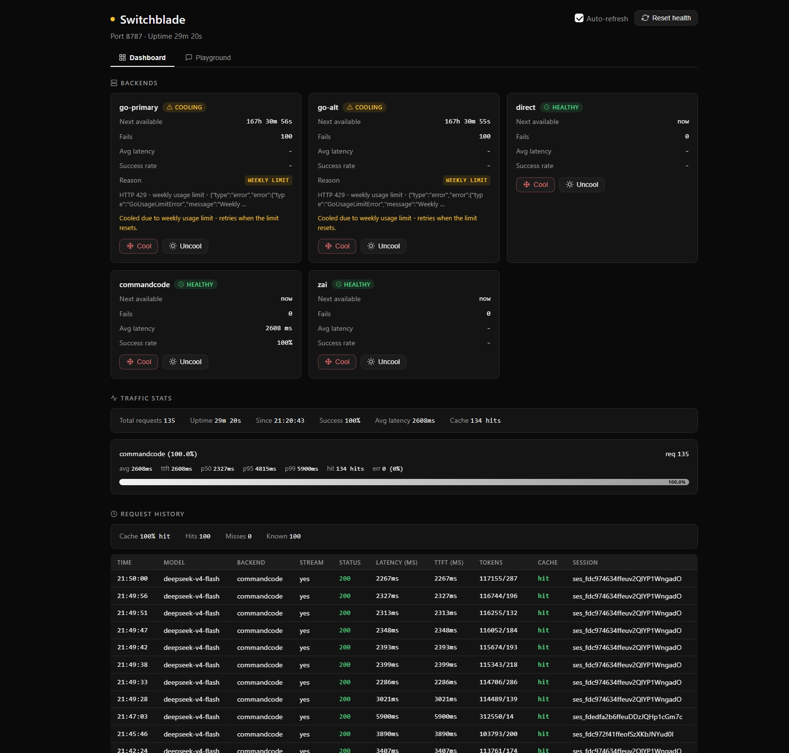

# Switchblade

A zero-dependency, single-file local model router for OpenAI-compatible LLM APIs.
It load-balances requests across multiple upstream providers (OpenCode Go,
DeepSeek, CommandCode, Z.ai, or any OpenAI-compatible endpoint), with
session-affinity hashing, per-provider health tracking, exponential backoff,
and a small web dashboard.

Runs entirely on your machine at `127.0.0.1:8787`. No Redis, no Postgres, no
Kubernetes, no cloud — one Node process, ~125 MB RAM idle, one config file.



## Why

Most self-hosted LLM routers are built for teams and clouds: they pull in a
database, a queue, a container stack, and a big dependency tree to solve
problems a small setup never has. If you have a handful of API keys and want to
spread requests across them with sane fallbacks, that weight is wasted.

This router is the opposite: **two source files, zero dependencies**, and a
config file you can read top to bottom. It was designed from the start to be
maintained by AI agents as much as humans — every behavior is pinned by a
mock-based test suite that runs in seconds with no keys and no network.

## How it works

Three layers:

- **backends** — raw upstream accounts (an OpenCode Go key, a DeepSeek key, a
  CommandCode key, a Z.ai key, or any OpenAI-compatible base URL).
- **models** — logical model ids bound to one or more providers (backend +
  upstream model string). One account can serve many models.
- **presets** — named routing policies over models, exposed to clients as model
  ids. Clients never address backends directly.

Routing is two-level: the preset strategy picks an ordered list of models;
each model then orders its providers by session affinity (pool =
`min(affinityPool, providers.length)`, primary = `hash(sessionKey) % pool`,
rest in declared order). The lists flatten into one attempt list, deduped by
backend, and the router retries through healthy members in order.

### Strategies

- **affinity** (default) — sessions stick to one backend (cache-friendly,
  conversation-coherent) while spreading across the pool. `affinityPool` 1
  degenerates to declared order (failover semantics).
- **failover** — strict declared order; first healthy model/provider serves.
- **weighted** — weighted-random primary, rest sorted by weight desc.

### Health & backoff

Health is tracked at two scopes. A **route** is one physical
`(backend, upstream)` pair — one account can serve many routes. An **account**
is the backend itself.

Account-level cooling (unchanged classes): 429 weekly-limit errors cool until
the weekly reset (parses `Resets in N days`); 429 generic is exponential
backoff, 30s base → 10 min cap; 401/403 is 1 min base → 30 min cap. Billing
failures cool the dry ACCOUNT and fail over to the next provider instead of
blocking the pool or blaming the caller: a literal `402 Payment Required`
(whatever its body says), or a `400`/`422` whose body matches
`insufficient (credits|quota|balance|funds)`, `insufficient_quota`,
`insufficient_balance`, `out of credits`, `no credits`, `billing error` or
`payment required`. 30s base → 5 min cap.

Route-level cooling: a server-class failure — 5xx, network, timeout, or a
completed `200` that carried no usable output — cools only the route that
produced it. One bad upstream model route no longer disables every other model
on the same account. The route backs off with the server policy (30s base → 5
min cap); the failure streak survives the timer, so a flapping route backs off
further each time instead of restarting at the base delay.

The **account** is cooled only on a real account outage: two DISTINCT routes of
the same backend failing inside 60s. One route failing twice does not count -
the escalation needs two different upstreams. A success clears its own route's
failure streak; the outage window itself is purely a 60s timeout.

**Opaque upstream rejections.** A `400`/`422` whose body carries no
explanation (empty, whitespace, message-less JSON, an unparseable fragment) is
classified `upstream_rejection`: it fails over to the next provider, it does
NOT blame the caller, and it excludes that route for that SESSION only, for
30s. The same payload may be fine on another provider. A body that DOES explain
itself (or a billing body) keeps its old meaning: the caller's payload was
rejected, and the real `400`/`422` is returned without failover.

**Strict eligibility — no fallback that tries a cooling provider anyway.** A
candidate is eligible only if its account is not cooling, its route is not
cooling, this session has not been excluded from it, and it is not already
being probed. Eligibility is rechecked immediately before each dispatch. When
nothing is eligible the router returns an honest `503` naming the scope
(`no provider is currently eligible for this request (1 route cooling, ...)`;
the all-manual case keeps its long-standing
`all available backends are cooling (N manually cooled - uncool to restore)`
wording) plus a `Retry-After` for the earliest finite recovery. A pool held
only by manual cools has no automatic recovery, so no `Retry-After` is sent.

**Recovery probes.** When a route's or account's cooldown expires, exactly ONE
request may probe it: the lease is claimed synchronously before any network
wait, and concurrent requests either wait or take another provider instead of
piling onto the recovering route. A `503` is therefore legitimate while a
probe is in flight (the router advertises a 1s hint).

**Failover first.** A retryable upstream error moves to the next eligible
provider immediately. The same-provider retry config (see below) only applies
when nothing else in the pool is eligible.

**Surface success, not the status line.** A route is marked healthy only at a
clean USABLE completion — parsed content, reasoning, or a tool call. A `200`
that carried none of those, a stalled stream, or a cut stream is charged to the
route as a failure and is still delivered to the caller unchanged (never
replayed). A caller that hangs up mid-stream is charged to nobody.

**Session provider preference.** The route that produced usable output becomes
that `(credential, session, logical model)` group's first choice, so a session
stays on the fallback that worked instead of re-probing the provider that
failed. Moving costs the prompt cache, and that is accepted. The map holds
10,000 entries with LRU eviction and no idle TTL: a healthy pin persists for
the life of the process (a restart clears it, like all health state). A pin is
only ever promoted inside its own logical-model group, so it never reorders
models; it is skipped when the pinned route is not currently eligible. It is
cleared when an operator cools, uncools, or resets a backend (the explicit
action wins over learned preference), and it is dropped when a config reload no
longer references the route. `/admin/reset-health` is an operator override, so it clears EVERY
layer that can hold a request off a provider: account cooling, route cooldowns,
session exclusions, the account-outage window, and the learned preferences. A
reset that left route cooldowns behind would report "healthy" while still
refusing to route. Callers whose session key resolves to
`no-session` get no preference at all.

Manual cools (from the UI or `POST /admin/backend`) are **sticky**: they never
participate in a fallback and are never cleared by a success. Only the Uncool
action (or a timed `forMs`) restores the backend — and that action also clears
the learned session preferences, so nothing keeps routing around it.

### Timeouts (connect vs idle)

Two independent per-backend bounds, set on the backend entry (or top-level):

- `timeoutMs` / `connectTimeoutMs` — **header wait**: aborts only if the
  upstream has not sent response headers (TTFT) within the bound. Default 45s.
- `idleTimeoutMs` — **stall bound on the body**: aborts only if NO bytes
  arrive for that long during streaming. Default 120s.

A slow-but-alive stream (long thinking, long generation) that keeps emitting
is never cut — the wall-clock body kill that used to terminate SSE relays
exactly at `timeoutMs` is gone. A genuinely stuck upstream (headers then
silence) still fails after `idleTimeoutMs`.

```jsonc
{ "id": "commandcode", "baseURL": "https://api.commandcode.ai/provider/v1",
  "apiKeyEnv": "COMMANDCODE_API_KEY",
  "timeoutMs": 60000, "idleTimeoutMs": 120000 }
```

The old `timeoutMs` value (45s default, 60s on commandcode) previously bounded
the ENTIRE request incl. the body, so long reasoning/generation streams were
aborted mid-flight exactly at the wall clock (see `router.log` "relay error:
The operation was aborted due to timeout").

### Per-model retries

On top of cooling, a model can retry a **transient** failure on the SAME
provider — but only when nothing else in the pool is eligible. Failover comes
FIRST: if another eligible provider exists, the router moves to it immediately
instead of consuming same-provider retries. The retry config still matters for
single-provider pools and gives chronically-overloaded free models a chance to
catch a free slot.

```jsonc
{
  "models": {
    "laguna-s-2.1-free": {
      "providers": [{ "backend": "commandcode", "upstream": "poolside/laguna-s-2.1-free" }],
      "retry": {
        "maxRetries": 5,   // how many retries before falling through (default 0 = off)
        "baseMs": 2000,    // first retry wait (default 1000)
        "maxMs": 30000,    // per-wait cap (default 8000)
        "multiplier": 2,   // exponential factor (default 2)
        "totalMs": 30000   // total retry-wait budget for one provider (default 15000)
      }
    }
  }
}
```

Retryable failures: 502/503/504, 429 with an `overload` message, network
errors (status 0). NOT retried: 429 weekly limits (GoUsageLimitError), auth
errors, explained 400/422 client payload errors, opaque 400/422
`upstream_rejection` bodies (retrying the same payload on the same provider
proves nothing — those fail over instead), and anything that has already started
streaming (a partially-relayed response can never be retried without
duplicating content). Retries never re-cool the backend; `markFailure` runs
once after retries are exhausted, exactly as before. History entries carry
`retries` (count) and `retryWaitedMs` (total ms waited).

### Layered parameters

Params merge from six layers, highest priority last:

```
global < backend.params < provider.params < model.params < preset.params < request body
```

`model` is reserved (always resolved to the provider's upstream string).
Per-provider dialect handling runs after merge: **dropParams first, then
paramMap**, then developer-role translation.

## Install

Requires Node.js 22+ (developed on 25; no Node-25-only APIs are used).

```bash
git clone <your-fork-or-this-repo>
cd switchblade
cp .env.example .env      # add your API keys
```

## Quickstart

1. Add your API keys to `.env` (key names are referenced from `config.json`
   via `apiKeyEnv`). A `.env.example` documents the known ones. You can also add
   and change them from the Config tab once the router is running: those writes
   go to the managed `secrets.json` and apply without a restart.
2. Edit `config.json` to your backends/models/presets (see below).
3. Run:

```bash
node server.mjs        # or: npm start
```

The router listens on `http://127.0.0.1:8787/v1`. Open `http://127.0.0.1:8787/`
for the web UI.

Point any OpenAI-compatible client at `http://127.0.0.1:8787/v1` with model =
a preset id. Example:

```bash
curl http://127.0.0.1:8787/v1/chat/completions \
  -H "Content-Type: application/json" \
  -d '{"model":"my-preset","messages":[{"role":"user","content":"hi"}]}'
```

## Config

Top-level keys: `port`, `prefix`, `masterKeyEnv`, `uiPasswordEnv`, `backends`,
`models`, `presets`, optional top-level `params`, `backoff`.

```jsonc
{
  "port": 8787,
  "prefix": "/v1",
  "backends": [
    { "id": "go-1", "baseURL": "https://opencode.ai/zen/go/v1",
      "apiKeyEnv": "OPENCODE_GO_KEY" },
    { "id": "direct", "baseURL": "https://api.deepseek.com/v1",
      "apiKeyEnv": "DEEPSEEK_API_KEY" }
  ],
  "models": {
    "deepseek-v4.1-flash": {
      "providers": [
        { "backend": "go-1", "upstream": "deepseek-v4.1-flash" },
        { "backend": "direct", "upstream": "deepseek-flash" }
      ],
      "affinityPool": 2,
      "meta": { "label": "DeepSeek V4.1 Flash", "contextWindow": 1000000,
                "pricing": { "inputPerM": 0.30, "outputPerM": 1.20 } }
    }
  },
  "presets": {
    "flash": { "strategy": "affinity", "models": ["deepseek-v4.1-flash"] }
  }
}
```

- **backends** — raw accounts: `id`, `baseURL`, `apiKeyEnv` (env var NAME; key
  values live in `.env`, never committed or exposed). Optional: `params`,
  `dropParams`, `translateDeveloperRole`.
- **models** — logical ids: `providers` (`backend` + `upstream` string,
  optional per-provider `params`, `dropParams`, `paramMap`), `affinityPool`
  (default 1), optional `params`, `meta` (label/contextWindow/pricing for the
  UI).
- **presets** — routing policies: `strategy`, `models` (string shorthand or
  `{model, weight}`), optional `affinityPool`, `params`, `meta`.

**Presets of presets (tier nesting):** a preset's `models` array may also
reference other preset ids. The nested preset's model list is expanded in place
at request time (recursively, with cycle detection), and the TOP-LEVEL preset's
strategy governs ordering over the expanded list. A nested preset's own
strategy is ignored — only its model list is taken. This lets you build tiers
that reuse each other:

```jsonc
"presets": {
  "glm":  { "strategy": "failover", "models": ["glm-5.3"] },
  "os-alpha": { "strategy": "affinity", "models": ["deepseek-v4.1-flash", "mimo-v2.5-pro"] },
  "super": { "strategy": "failover", "models": ["glm", "os-alpha"] }
}
```

`super` routes through `[glm-5.3, deepseek-v4.1-flash, mimo-v2.5-pro]` in
declared order (failover). Cycles (`A -> B -> A`) are cut with a one-time
warning and never hang the router. See `DESIGN-3LAYER.md` section 3a for the
full contract.

Config hot-reloads via `fs.watch` (~300 ms) — no restart needed. Validate JSON
before saving.

### Environment variables

Three layers, highest precedence first: the **real process environment** (a
variable exported in your shell, or injected by a platform such as Coolify),
then the **managed `secrets.json`** written by the Config tab, then **`.env`**.
The managed store also hot-reloads via `fs.watch`, so a value saved in the UI
reaches the running process without a restart.

`.env` is read once at startup and is the bootstrapping fallback: it wins for
nothing that a higher layer defines, and it stays editable in the env editor:
saving a new value for a `.env`-declared name moves it into the managed store,
which outranks the file. A variable the real environment owns is never
overridden by the store, and the UI labels it `shell` so the shadowing is
visible rather than silent; such a name is reported `editable: false` and a
write to it is refused (400) with the owner named. `GET /api/env` reports
`source` and `live` per variable for exactly this reason.

### Backward compatibility

Legacy configs keep working: an old `models[id] = {backends, affinityPool}`
schema and a presets-with-`members` schema both auto-normalize to the
three-layer shape at load, byte-identically for identical effective configs.

## Endpoints

| Method | Path | Purpose |
|--------|------|---------|
| GET | `/health` | per-backend health (`state`, `fails`, `lastError`, `manual`, `probeInFlight`) plus a `deployments` array on each backend row and a `routes` array. Both list every route the CONFIG DECLARES, not only the ones that have failed: a route with no history is still a deployment you can read the state of. A route row carries `id` (the owning backend), `backend`, `upstream`, `models`, `state` (`cooling`/`probing`/`healthy`), `fails`, `nextAvailableAtMs`, `retryInMs`, `probeInFlight`, `lastErrorKind`, `lastStatus`, `manual`. An account-wide manual block shows on every route of that account |
| GET | `/v1/models` | OpenAI-compatible model list (preset ids) |
| POST | `/v1/chat/completions` | chat completions (stream + non-stream) |
| GET | `/api/stats` | traffic stats |
| GET | `/api/dashboard` | analytics aggregates for the Dashboard tab (KPIs, per-backend/per-model, hourly/daily series, cooling timeline, pricing) |
| GET | `/api/history?limit=N` | request history (default 100, clamp 1..500) |
| GET | `/api/history/detail?t=<timestamp>` or `?call=<callId>` | deep-dive detail for one history entry (payload, attempts, response summary) |
| GET | `/api/config` | normalized config (env NAMES only, never key values) |
| GET | `/api/auth/status` | dashboard auth state (`passwordSet`, `uiAuthed`); never echoes the password |
| POST | `/api/auth/login` | `{password}` -> sets the UI session cookie; 401 wrong password, 429 throttled (5 attempts / 10s per IP) |
| POST | `/api/auth/logout` | clears the UI session cookie |
| GET | `/api/keys` | issued chat-only keys (`id`, `name`, `createdAt`, `revoked`; never hashes or raw values); master key required |
| POST | `/api/keys` | `{name}` -> issues a chat-only key, raw value returned once; master key required |
| DELETE | `/api/keys?id=<id>` | revokes an issued key; master key required |
| GET | `/api/env` | env var NAMES with `set`/`editable`/`reloadable`/`source`/`live`; never values; admin required |
| POST | `/api/env` | `{name, value, baseRevision}` -> writes the managed secrets store; 400 for protected or shell-owned names; 409 on a stale revision; admin required |
| POST | `/api/env/reveal` | `{name}` -> `{name, value}` for ONE variable; 400 for protected auth names and for names outside the editor's set (config-referenced, managed, or `.env`-declared); admin required |
| DELETE | `/api/env?name=X` | removes a managed variable; 409 for `.env`/shell-sourced names; admin required |
| POST | `/admin/reset-health` | reset every cooling layer (accounts, routes, session exclusions, the account-outage window) and the learned session preferences |
| POST | `/admin/backend` | `{id, action: "cool"\|"uncool", forMs?, upstream?}` manual cool/uncool. Without `upstream` the block is account-wide; with it the action is narrowed to ONE physical route, which must be a route some model declares (400 malformed, 404 undeclared) |
| GET | `/` | web UI |

History lives in an in-memory ring buffer (500 entries) and appends to
`router-history.jsonl` (override with `ROUTER_HISTORY`).

## Security

- **Dashboard password** — set `uiPasswordEnv` in `config.json` to the name of
  an env var (`.env`: `LMR_UI_PASSWORD`) to require a login for the web UI.
  When the env var is unset the UI stays open. Login is throttled (5 attempts
  per 10s per client IP) and the session cookie is `HttpOnly`/`SameSite=Strict`.
- **Master key** — `masterKeyEnv` names the env var holding the chat/admin
  master key (`LITELLM_API_KEY` locally, the value dsh and OpenCode already
  send). It gates `POST /v1/chat/completions`, `/admin/*`, and `/api/keys`;
  set-but-empty fails closed.
- **Issued keys are chat-only** — keys created via `POST /api/keys` unlock chat
  completions but never `/admin/*` (admin stays master-key-only). Only SHA-256
  hashes are stored, in `api-keys.json` (gitignored).
- **Env editor** — the Config tab can add and change credential env vars. Values
  live in a managed `secrets.json` (gitignored, snapshotted to `secrets.history/`;
  override the path with `ROUTER_SECRETS`). The list endpoint serves NAMES and
  state only; a value is returned solely by the explicit per-variable reveal
  call, which is scoped to the same set the list serves (config-referenced
  names, the managed store, and `.env`-declared names) so it cannot be used to
  read arbitrary process variables. `masterKeyEnv` and `uiPasswordEnv` are
  rejected on write server-side,
  because they are the credentials that unlock the editor itself, and they are
  also refused by reveal: the dashboard session is gated by `uiPasswordEnv`,
  while the master key is a wider-scope machine credential, so exposing it would
  let a dashboard password escalate to the machine credential. Writes
  hot-reload in roughly 300 ms; names in `STARTUP_ONLY_VARS` take effect on the
  next start and are reported as `reloadable: false`.
- **Read-only endpoints stay open** — `/health`, `/v1/models`, `/api/stats`,
  `/api/history`, `/api/config`, `/api/auth/*`, and `/` never require a key.

### Call IDs

Every request gets a short, stable `callId` (e.g. `c09AlJGPME`), returned in the
`x-router-call` response header, stored on its history entry, and shown as the
**Call** column of the dashboard's request history (with a copy button). Use it
to reference a specific request in conversation, logs, or scripts — the detail
endpoint accepts it as `?call=<callId>` (falling back to `?t=<timestamp>` for
pre-callId rows).

### Request detail deep dive

Click any row in the dashboard's request history to open a slide-out panel with
the full debug picture for that request:

- **Outgoing request payload** — the exact JSON sent upstream (messages
  included, syntax-highlighted). API keys are never part of the payload, so
  nothing sensitive is stored.
- **Per-attempt details** — every backend tried, the upstream model string, the
  status and latency of each attempt, and the raw upstream error body when an
  attempt failed.
- **Response summary** — status, timing (TTFT / total / generation), token
  usage, cache state, and a first-content preview (truncated to 200 chars).

Detail records are stored **in memory only** (never written to
`router-history.jsonl`), capped at **100 records** (oldest dropped). Every
request gets a detail record; oversized bodies (raw payload > 100 KB) are
stored truncated (message content clipped, tool schemas kept to a few) so the
panel never silently 404s. The panel closes via the X button, the Escape key,
or clicking outside.

## Web UI

`index.html` — single file, inline CSS + JS, zero external assets, works
offline. Dashboard: backend cards with live cooling countdowns, traffic stats
with p50/p95/p99 and cache-hit %, presets table, models table, request history
with per-request call IDs (copyable), TTFT/TPS/tokens/cache columns and a
click-to-open detail panel per row, config viewer, and a playground that can
stream a chat, show reasoning, compare models side by side, and export the
conversation.

Dashboard analytics: the Dashboard tab adds a KPI strip, spend/tokens/latency/
error charts with peak-window shading, backend/model/cache donuts, savings
badges for cache and off-peak discounts, a cooling timeline, and a filterable
request history with a cost column. All of it is fed by `GET /api/dashboard`,
seeded at startup from the `router-history.jsonl` tail so charts survive
restarts; the contract is in DESIGN-3LAYER.md section 14.

## Test

```bash
npm test   # node test.mjs
```

The suite spins up mock backends plus router instances
on temp configs — no keys, no network. It covers health, streaming, session
affinity, failover, weighted selection, sticky/timed manual cools, fallback
exclusion, route-scoped cooling (a sibling route succeeding is not an account
outage), opaque 400/422 rejections (fail over, session-scoped exclusion, never
blame the caller), strict eligibility and the honest 503 + `Retry-After`,
recovery probes (one at a time), failover-first retries, session stickiness
after a fallback, unusable-`200` handling (charged to the route, delivered to
the caller unchanged), dialect handling, synthesis from both legacy eras, the
layered-params merge order, preset-of-presets nesting (expansion, cycle
detection, ordering rules), per-model retry/backoff, the request-detail
endpoint, the analytics dashboard (cost engine, /api/dashboard aggregates,
cooling timeline), and the env editor (auth gate, list scoping, precedence,
protected names, stale-revision conflicts, snapshots, and hot reload).

## Design docs

- `DESIGN-3LAYER.md` — the three-layer contract (backends/models/presets,
  routing, layered params, verification checklist).
- `DESIGN-PRESETS.md` — the presets layer, sticky manual-cool semantics, and
  what a manual cool clears.
- `SPEC.md` — original spec and verification plan.

## Contributing

PRs welcome. The rules are simple:

- Keep it zero-dependency. No new npm packages without a strong reason.
- Every behavior change ships with a test in `test.mjs` (mock backends, no
  keys).
- The config contract and its synthesis paths are load-bearing; change them
  only with a documented design note.

## License

MIT. See `LICENSE`.
